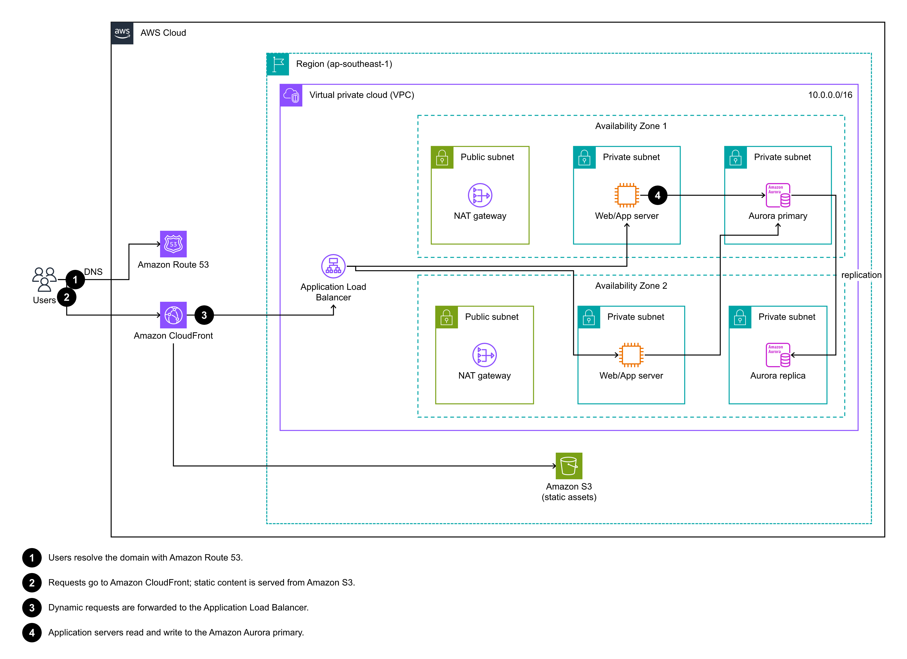

# aws-architecture-draw

A Claude skill (it also works as a plain CLI) that draws **AWS architecture diagrams** that follow the official
**AWS Architecture Icons** guidelines, using the official icon set (release `07312026`). It exports:

- **`.drawio`**: editable in draw.io / diagrams.net / the VS Code draw.io extension, with real nested groups
- **`.svg`** and **`.png`**: for docs and slides (light and dark themes)



## How it works

```
YAML spec ──► validate (guideline rules) ──► structure-first layout ──► orthogonal arrow routing ──► .drawio / .svg / .png
```

- **Icons**: the official asset package (SVG only) is in `icons/`. `catalog/icons.json` indexes 302 services,
  419 resources and 47 general icons, with aliases (`s3`, `alb`, `nat`, `lambda`, ...).
- **Guidelines**: these were extracted from the official deck (`AWS-Architecture-Icons-Deck_For-Light/Dark-BG_07312026.pptx`):
  group colors and line styles, a 48 px icon size, 12 pt Arial labels on at most 2 lines, 1.25 pt open arrows, and numbered callouts.
  See [references/guidelines.md](references/guidelines.md) and the machine-readable [catalog/guidelines.json](catalog/guidelines.json).
- **Layout**: groups are laid out first (AWS Cloud → Region → VPC → AZ → subnet), with AZs side by side.
  Arrows are then routed on an 8 px grid with right angles, avoiding icons and labels.

## Use

```bash
npm install
node scripts/render.mjs examples/three-tier-web.yaml --out out
node scripts/find-icon.mjs "load balancer"
node scripts/validate.mjs my-diagram.yaml --strict
```

Spec format: [references/spec.md](references/spec.md). Examples: [examples/](examples/).

### As a Claude skill

Copy or clone this folder into your skills directory (e.g. `~/.claude/skills/aws-architecture-draw`) and run `npm install` in it.
[SKILL.md](SKILL.md) tells Claude how to write the spec, render it, check the PNG and iterate.

## Updating the icons (AWS releases them quarterly)

1. Download the asset package from <https://aws.amazon.com/architecture/icons/> and extract it.
2. `node scripts/import-icons.mjs <extracted-folder>`
3. `npm run catalog`
4. Check the new deck for guideline changes and update `catalog/guidelines.json` and `references/guidelines.md` to match.

## Notes

- The icons are © Amazon Web Services and are subject to AWS's terms for the Architecture Icons.
  AWS allows them to be used for creating architecture diagrams.
- Known limitation: icons in differently nested groups may sit a few pixels apart, which adds a single elbow to the arrow between them.
